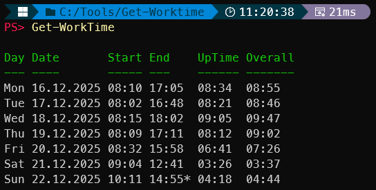
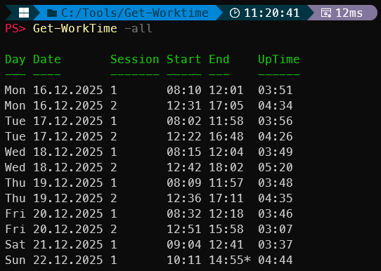

# Get-WorkTime


*Get-WorkTime* is a small PowerShell module that reads boot, wake, shutdown, sleep, and hibernate events from the Windows System event log and presents them as simple work-time summaries.

It was primarily created to track personal work times, such as:
- When the computer was first started in the morning
- When it was shut down or suspended at the end of the day
- How long the system was actually running during the day

The module provides:
- A daily overview with start time, end time, total system-on time, and overall time span
- An optional detailed session view showing individual work sessions within a day
- Output as structured PowerShell objects, making it easy to further process or analyze the data via the pipeline

Short interruptions (for example quick reboots or restarts) can be merged into a single session, and days that ended without a clean shutdown (e.g. due to crashes) are handled by inferring the end time from the last available system event.

---

## Features

- Daily summary of system start and end times
- Optional detailed session view (`-All`)
- Calculates UpTime (sum of all sessions) and Overall time span per day (difference between the first start and final end)
- Missing shutdown events (e.g. crashes) are inferred and marked with `*`
- Short gaps between sessions can be merged
- Optional raw output mode (`-Raw`) for pipeline-friendly processing with typed `DateTime` / `TimeSpan` values

---

## Installation

### Manual installation

1. Clone the repository:
    ```powershell
   git clone https://github.com/zh54321/Get-WorkTime
   ```
2. Import the module before usage:
   ```powershell
   Import-Module ./Get-WorkTime/Get-WorkTime.psm1
   ```
3. Autoload on boot (optional):  
To enable automatic module loading, copy the entire Get-WorkTime folder into your PowerShell module directory: C:\Users\<YourUser>\Documents\WindowsPowerShell\Modules

### Automatic

Run the following PowerShell commands to install the module for the current user:

```powershell
$modulePath = Join-Path $HOME "Documents\WindowsPowerShell\Modules"

git clone https://github.com/zh54321/Get-WorkTime (Join-Path $modulePath "Get-WorkTime")

# Import the module
Import-Module Get-WorkTime
```
---

## Usage
```powershell
Get-WorkTime
Get-WorkTime -Days 14
Get-WorkTime -All
Get-WorkTime | Export-Csv worktime.csv -NoTypeInformation
```


## Parameters

| Parameter           | Description                                                                 | Default |
|---------------------|-----------------------------------------------------------------------------|---------|
| `-Days`             | Number of days to include (including today).                                | `7`     |
| `-All`              | Show detailed per-session view instead of the daily summary.                | (off)   |
| `-MergeGapMinutes`  | When `-All` is used, treat a start that occurs within this many minutes after the previous end as a continuation of the same session (merge small gaps, e.g. quick reboot). | `3` |
| `-Raw`              | Return clean, pipeline-friendly objects (DateTime/TimeSpan values, no `-` or `*` markers). Includes additional typed properties such as `DayOfWeek`. | off |

---

## Screenshots

### Daily summary view

Shows one row per day with:
- first system start
- last system end
- total *UpTime* (sum of all sessions)
- *Overall* time span (first start → last end)



### Detailed session view (`-All`)

Shows individual system-on sessions with start time, end time, and UpTime.



---

