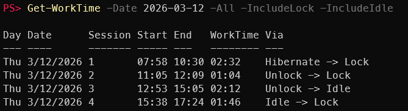
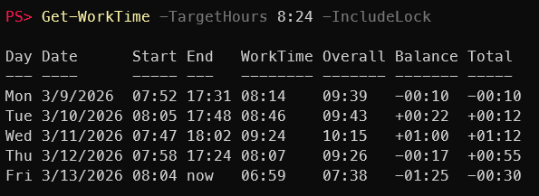
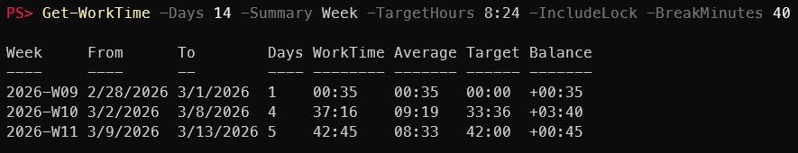
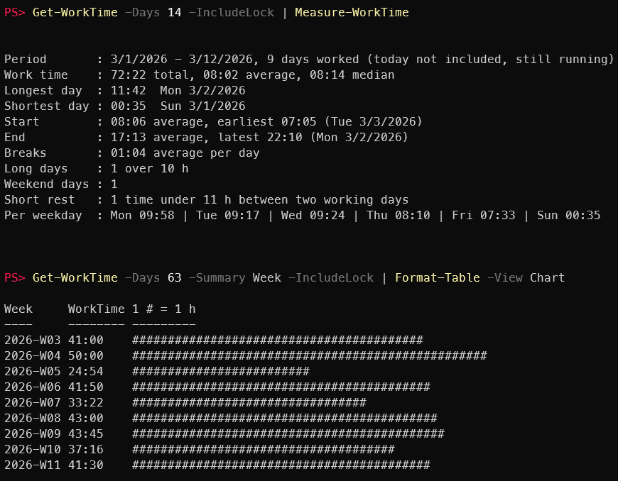

# Get-WorkTime

*Get-WorkTime* is a small PowerShell module that reads boot, wake, shutdown, sleep, standby and hibernate events from the Windows event log and presents them as simple work-time summaries.

It was primarily created to track personal work times, such as:
- When the computer was first started in the morning
- When it was shut down or suspended at the end of the day
- How long you actually worked on it, with or without breaks such as standby or a locked lunch

The module provides:
- A daily overview with start time, end time, work time (without the detected breaks) and overall time span
- An optional detailed session view showing the individual sessions within a day, including how each one started and ended
- Output as structured PowerShell objects, making it easy to further process or analyze the data via the pipeline


More views: sessions, overtime, weekly totals, statistics and charts, see [Screenshots](#screenshots).

---

## Features

- Daily summary of system start and end times, or the individual sessions (`-All`)
- Any period: the last N days, a single day or a date range (`-Days`, `-Date`, `-From`/`-To`)
- WorkTime (sum of all sessions, without the detected breaks: standby, sleep, shutdown and optionally locks and idle) and Overall time span (first start to last end) per day
- Totals per week or month (`-Summary`)
- Overtime / undertime against a daily target, with a running total (`-TargetHours`)
- Statistics (`Measure-WorkTime`): averages, longest days, start and end times, breaks, rest, per weekday, … and simple bar charts (`Format-Table -View Chart`)
- Shutdown, sleep (S3), Modern Standby (S0, typical for current laptops: lid closed, power button, Start menu) and hibernation count as breaks
- Optional: screen turned off after inactivity (`-IncludeIdle`) and workstation lock (`-IncludeLock`) as breaks
- Short interruptions (quick restart, brief idle or lock) are not counted as breaks (`-OffMinutes`, `-BreakMinutes`)
- Shows how each session started and ended (`Via` column, e.g. `Boot -> Standby`, `Standby -> Hibernate`)
- Crashes / power loss are detected (new boot while a session is still open); the inferred end is marked with `*`
- Sessions past midnight are split per day (`24:00` / `00:00`); a session that is still running ends with `now`
- Returns PowerShell objects with real `DateTime` / `TimeSpan` values, ready for post-processing: export to CSV/Excel, filter, group, sum up (see [Usage](#usage) and [Output](#output)); the table is only the display
- `-Verbose` for a summary, `-Debug` for a per-event trace (troubleshooting)
- Keep a history beyond the event log retention: `Export-WorkTime` appends completed days (or sessions) to a CSV file (see [Keeping more history](#keeping-more-history-export-worktime))

---

## Requirements

- Windows, PowerShell 7 or Windows PowerShell 5.1
- No admin rights needed

---

## Installation

### Manual installation

1. Clone the repository:
   ```powershell
   git clone https://github.com/zh54321/Get-WorkTime
   ```
2. Import the module before usage:
   ```powershell
   Import-Module ./Get-WorkTime/Get-WorkTime.psd1
   ```
   Import the `.psd1` (or the folder), not the `.psm1`. Otherwise the table formatting is not loaded.
3. Optional: to have PowerShell load the module automatically on first use, copy the entire `Get-WorkTime` folder into your PowerShell module directory:
   - PowerShell 7: `Documents\PowerShell\Modules`
   - Windows PowerShell 5.1: `Documents\WindowsPowerShell\Modules`

### Automatic

Run the following commands to install the module for the current user (works in PowerShell 7 and Windows PowerShell 5.1):

```powershell
$modulePath = Join-Path ([Environment]::GetFolderPath('MyDocuments')) $(
    if ($PSVersionTable.PSEdition -eq 'Core') { 'PowerShell\Modules' } else { 'WindowsPowerShell\Modules' }
)

git clone https://github.com/zh54321/Get-WorkTime (Join-Path $modulePath 'Get-WorkTime')

# Import the module
Import-Module Get-WorkTime
```

---

## Usage

### Basics

```powershell
Get-WorkTime                                  # daily summary, last 7 days
Get-WorkTime -Days 14                         # last 14 days
Get-WorkTime -All                             # individual sessions instead of the daily summary
Get-WorkTime yesterday -All                   # one day
Get-WorkTime -Date 2026-10-05                 # one day
Get-WorkTime -From Monday                     # since the most recent Monday
Get-WorkTime -All -IncludeIdle -IncludeLock   # idle (screen off) and locks over 15 min are breaks
```

### Breaks

Which breaks count as work time is up to you, e.g. short (paid) breaks count, lunch does not.

| What happens | Counts as a break |
|---|---|
| Lid closed, standby, sleep, hibernate, shutdown | if longer than `-OffMinutes` (default 3 minutes) |
| Workstation locked (`-IncludeLock`) | only if longer than `-BreakMinutes` (default 15) |
| Screen turned off after inactivity (`-IncludeIdle`) | only if longer than `-BreakMinutes` (default 15) |
| Locked / idle without the switches | never: counts as work time |

Example: one day with a short lock (7 min), a meeting away from the desk (locked, 35 min), lunch (locked and lid closed, 44 min) and a phone call away from the desk (screen off, 33 min):

```powershell
Get-WorkTime -Date 2026-03-12 -TargetHours 8:24                                        # only the lunch (lid closed) is a break
Get-WorkTime -Date 2026-03-12 -TargetHours 8:24 -IncludeLock -IncludeIdle              # breaks over 15 min: meeting, call and lunch
Get-WorkTime -Date 2026-03-12 -TargetHours 8:24 -IncludeLock -IncludeIdle -BreakMinutes 40   # breaks up to 40 min count as work: only the lunch
```

| Command | WorkTime | Balance |
|---|---|---|
| without switches | 08:45 | +00:21 |
| `-IncludeLock -IncludeIdle` | 07:34 | -00:50 |
| `-IncludeLock -IncludeIdle -BreakMinutes 40` | 08:42 | +00:18 |

`-All` shows which breaks were taken into account (column `Via`, e.g. `Unlock -> Lock`). Use the same switches every time, also for [`Export-WorkTime`](#keeping-more-history-export-worktime), so the results stay comparable.

### Totals and overtime

```powershell
Get-WorkTime -From Monday -TargetHours 8:24 -IncludeLock     # balance per day and running total
Get-WorkTime -Days 28 -Summary Week -IncludeLock             # total and average per week
Get-WorkTime -From 2026-01-01 -Summary Month -TargetHours 8.4 -IncludeLock
```

```
PS> Get-WorkTime -Days 14 -Summary Week -TargetHours 8:24 -IncludeLock -BreakMinutes 40

Week     From       To         Days WorkTime Average Target Balance
----     ----       --         ---- -------- ------- ------ -------
2026-W09 28.02.2026 01.03.2026 1    00:35    00:35   00:00  +00:35
2026-W10 02.03.2026 08.03.2026 4    37:16    09:19   33:36  +03:40
2026-W11 09.03.2026 13.03.2026 5    42:45    08:33   42:00  +00:45
```

Locks of up to 40 minutes count as work time here (`-BreakMinutes 40`, see [Breaks](#breaks)).

The balance is only as accurate as the break detection. Without switches, only times the computer is off (lid closed, standby, sleep, shutdown) count as breaks; a locked lunch or a meeting away from the desk count as work time. The current week (09.-13.03.) in the daily view, with the default `-BreakMinutes` of 15 minutes:

| Command | Total |
|---|---|
| `Get-WorkTime -TargetHours 8:24` | +00:57 |
| `Get-WorkTime -TargetHours 8:24 -IncludeLock` | -00:30 |
| `Get-WorkTime -TargetHours 8:24 -IncludeLock -IncludeIdle` | -01:03 |

So if you lock your workstation during breaks, use `-IncludeLock` (and `-IncludeIdle` if you sometimes leave without locking) together with `-TargetHours`. To avoid typing them every time, see [Your own defaults](#your-own-defaults).

By default only weekdays you worked have a target: days off (vacation, holidays) count nothing, work on the weekend counts fully as overtime. `-TargetDays` changes this (see [Parameters](#parameters-get-worktime)).

### Processing the output

```powershell
Get-WorkTime -From 2026-09-01 -To 2026-09-30 | Export-Csv worktime-09.csv -NoTypeInformation

# Total work time of a month in hours
(Get-WorkTime -From 2026-09-01 -To 2026-09-30 | ForEach-Object { $_.WorkTime.TotalHours } | Measure-Object -Sum).Sum

# Days with more than 9 hours
Get-WorkTime -Days 30 | Where-Object { $_.WorkTime -gt [TimeSpan]'09:00' }

Get-WorkTime -Days 30 -All | Group-Object EndType            # how did the sessions end?
Get-WorkTime -Days 30 -All | Where-Object EndType -eq Crash   # all crashes
Get-WorkTime -Date Friday -All -Debug                         # why does Friday look like this?

# This week to the clipboard, then paste into Excel (Ctrl+V fills separate columns; hours as decimal number)
Get-WorkTime -From Monday | ForEach-Object {
    $end = if ($_.EndTime -eq $_.Date.AddDays(1)) { '24:00' } else { $_.EndTime.ToString('HH:mm') }
    "{0:d}`t{1:HH:mm}`t{2}`t{3:0.00}" -f $_.Date, $_.StartTime, $end, $_.WorkTime.TotalHours
} | Set-Clipboard

# When do I start? Distribution of the start times per hour
Get-WorkTime -Days 90 | Where-Object StartType -ne Continued | Group-Object { $_.StartTime.Hour } |
    Sort-Object { [int]$_.Name } | ForEach-Object { '{0:00}:00  {1}' -f [int]$_.Name, ('#' * $_.Count) }
```

For averages, longest days, rest and more see [Statistics and charts](#statistics-and-charts).

### Date input

`-Date`, `-From` and `-To` accept:
- a date in your regional format (e.g. `05.10.2026` on de-CH, `10/5/2026` on en-US) or ISO format (`2026-10-05`)
- `today`, `yesterday` or a day offset (`0` = today, `-1` = yesterday, `-7` = a week ago)
- a day name in English or your language (`Monday`, `Montag`, `Mo`): the most recent such day, today included
- a `[datetime]` object, e.g. `(Get-Date).AddDays(-3)`

### Your own defaults

PowerShell can remember parameter values per command (`$PSDefaultParameterValues`). Add the lines you need to your profile (`notepad $PROFILE`), e.g. a daily target of 8:24 and locks as breaks:

```powershell
$PSDefaultParameterValues['Get-WorkTime:TargetHours']    = '8:24'
$PSDefaultParameterValues['Get-WorkTime:IncludeLock']    = $true
$PSDefaultParameterValues['Export-WorkTime:IncludeLock'] = $true   # export calculated the same way
```

PowerShell 7 and Windows PowerShell 5.1 have separate profiles, so add the lines to each one you use. A plain `Get-WorkTime` then shows the balance with locks as breaks. A value on the command line wins, e.g. `Get-WorkTime -IncludeLock:$false`. `-TargetHours` is ignored with `-All`.

---

## Statistics and charts

Pipe the daily rows of `Get-WorkTime` into `Measure-WorkTime`. The period, the switches and any filter are up to you:

```powershell
Get-WorkTime -Days 90 | Measure-WorkTime
Get-WorkTime -From 2026-01-01 -IncludeLock -TargetHours 8:24 | Measure-WorkTime -Detailed
Get-WorkTime -Days 90 | Measure-WorkTime -ExcludeWeekends                             # weekdays only
Get-WorkTime -Days 90 | Where-Object { $_.Date.Month -eq 9 } | Measure-WorkTime        # any filter, e.g. September only

# Breaks only from 30 minutes: shorter locks and idle times count as work time
Get-WorkTime -Days 90 -IncludeLock -IncludeIdle -BreakMinutes 30 | Measure-WorkTime

# The same, and also a lid closed (standby) for less than 30 minutes counts as work time
Get-WorkTime -Days 90 -IncludeLock -IncludeIdle -BreakMinutes 30 -OffMinutes 30 | Measure-WorkTime
```

```
PS> Get-WorkTime -Days 14 -IncludeLock | Measure-WorkTime

Period       : 01.03.2026 - 12.03.2026, 9 days worked (today not included, still running)
Work time    : 72:22 total, 08:02 average, 08:14 median
Longest day  : 11:42  Mon 02.03.2026
Shortest day : 00:35  Sun 01.03.2026
Start        : 08:06 average, earliest 07:05 (Tue 03.03.2026)
End          : 17:13 average, latest 22:10 (Mon 02.03.2026)
Breaks       : 01:04 average per day
Long days    : 1 over 10 h
Weekend days : 1
Short rest   : 1 time under 11 h between two working days
Per weekday  : Mon 09:58 | Tue 09:17 | Wed 09:24 | Thu 08:10 | Fri 07:33 | Sun 00:35
```

- `-Detailed` adds: spread of the day lengths, most common start hour, late evenings (ending after 20:00), long weeks, longest run of working days, trend (second half of the period vs. first half), busiest week and how the days ended (`Shutdown 75 %, Standby 12 %, …`).
- With `-TargetHours` input: total balance and days over / under target.
- A day that is still running (today) is not included, since it would distort the averages; `-IncludeToday` includes it.
- Start statistics ignore days that started the day before, end statistics days without a real end (still running at midnight or now). Short rest is the time between the end of one working day and the start of the next one.
- The result is an object with typed properties, e.g. `(Get-WorkTime -Days 30 | Measure-WorkTime).AverageStart`.

| Parameter | Description | Default |
|-----------|-------------|---------|
| `-Detailed` | Show all statistics. The returned object is the same. | off |
| `-IncludeToday` | Also include the day that is still running. | off |
| `-ExcludeWeekends` | Leave out Saturdays and Sundays (e.g. a short check of mails on Sunday). `Weekend days` still counts them. | off |
| `-LongDayHours` | A day with more work time counts as a long day. | `10` |
| `-LongWeekHours` | An ISO week with at least this much work time counts as a long week. | `50` |
| `-MinRestHours` | Rest between two working days shorter than this counts as short rest. | `11` |

Bar charts per day, week or month:

```powershell
Get-WorkTime -Days 14 | Format-Table -View Chart
Get-WorkTime -Days 84 -Summary Week | Format-Table -View Chart
Get-WorkTime -From 2026-01-01 -Summary Month | Format-Table -View Chart
```

```
PS> Get-WorkTime -Days 63 -Summary Week -IncludeLock | Format-Table -View Chart

Week     WorkTime 1 # = 1 h
----     -------- ---------
2026-W03 41:00    #########################################
2026-W04 50:00    ##################################################
2026-W05 24:54    #########################
2026-W06 41:50    ##########################################
2026-W07 33:22    #################################
2026-W08 43:00    ###########################################
2026-W09 43:45    ############################################
2026-W10 37:16    #####################################
2026-W11 41:30    ##########################################
```

The scale is fixed per view: day 1 `#` = 15 min, week 1 `#` = 1 h, month 1 `#` = 4 h. The chart only changes the display; the objects stay the same.

---

## Parameters (`Get-WorkTime`)

| Parameter          | Description | Default |
|--------------------|-------------|---------|
| `-Days`            | Number of days to include (including today). | `7` |
| `-Date`            | Report a single day (positional: `Get-WorkTime yesterday`). Cannot be combined with `-Days` or `-From`/`-To`. | |
| `-From` / `-To`    | Report a date range; both days are included. Cannot be combined with `-Days` or `-Date`. | `-To`: today |
| `-All`             | Show the individual sessions instead of the daily summary. | off |
| `-IncludeIdle`     | Also treat `Idle` (screen turned off after inactivity) as a break. Without it, idle is ignored completely, so e.g. a notebook left open overnight counts as running until it hibernates or is used again. | off |
| `-IncludeLock`     | Also treat workstation lock/unlock as end/start of a session, so locked time does not count. After a wake on the lock screen, the session starts at the unlock. No admin rights needed; the lock/unlock log may only cover a few weeks (see [Keeping more history](#keeping-more-history-export-worktime)). | off |
| `-BreakMinutes`    | With `-IncludeIdle` / `-IncludeLock`: idle and locks only count as a break if they last longer than this; shorter ones count as work time. `0` = every idle/lock is a break. | `15` |
| `-OffMinutes`      | If the system was off (restart, sleep, standby, hibernate) for up to this many minutes, it is not a break: the previous session continues. `0` = every off period is a break. Alias: `-MergeGapMinutes` (name before version 2.0). | `3` |
| `-TargetHours`     | Daily target, as hours:minutes (`8:24`) or hours (`8.4`). Adds `Balance` (WorkTime minus target) and a running `Total` to the daily summary, and `Target` / `Balance` to `-Summary`. Ignored with `-All`. | |
| `-TargetDays`      | Which days have a target: `WorkedWeekdays` = Mon-Fri with work; `Weekdays` = every Mon-Fri, also without work (shown as a row with `00:00`); `WorkedDays` = every day with work, also on the weekend. | `WorkedWeekdays` |
| `-Summary`         | `Week` or `Month`: one row per ISO week (Monday to Sunday) or calendar month with days worked, total and average WorkTime. Not with `-All`. | |
| `-Raw`             | Skip the table view and show the plain property values. The returned objects are the same (see [Output](#output)). | off |
| `-Verbose`         | Summary: range, state at range start, events read, sessions and how they ended. | off |
| `-Debug`           | Every start/end event and what was done with it (troubleshooting). | off |

---

## Output

Daily summary (default) and sessions (`-All`) are objects with these properties:

| Property | Description |
|----------|-------------|
| `Day`, `DayOfWeek`, `DayOfWeekNumber`, `Date` | The day (localized short name, enum, 0-6, `DateTime`) |
| `Session` | Number of the session within the day (`-All` only) |
| `StartTime`, `EndTime` | `DateTime` |
| `WorkTime` | `TimeSpan`: duration of the session, or sum of all sessions of the day (called `UpTime` before version 2.0) |
| `Overall` | `TimeSpan`: first start to last end (daily summary only) |
| `Sessions` | Number of sessions of the day (daily summary only) |
| `StartType`, `EndType` | How the session (or day) started and ended, see below |
| `IsInferred` | End inferred after a crash or power loss (shown as `*`) |
| `IsRunning` | Still running now (shown as `now`) |
| `Target`, `Balance`, `Total` | `TimeSpan`, with `-TargetHours` (daily summary): target of the day, WorkTime minus target, running total of the balance |

With `-Summary`, one object per period: `Week` (e.g. `2026-W11`) or `Month` (e.g. `2026-03`), `From`, `To`, `Days` (days worked), `WorkTime`, `Average` (per day worked), and with `-TargetHours` also `Target` and `Balance`.

### Start and end types

Shown as `Via` with `-All`:

| StartType   | Meaning                                   | EndType     | Meaning                                    |
|-------------|-------------------------------------------|-------------|--------------------------------------------|
| `Boot`      | System started                            | `Shutdown`  | Shut down                                  |
|             |                                           | `Restart`   | Restarted (only if longer than `-OffMinutes`, otherwise merged) |
| `Sleep`     | Woke from sleep                           | `Sleep`     | Went to sleep                              |
| `Standby`   | Left Modern Standby                       | `Standby`   | Entered Modern Standby (lid, power button, Start menu) |
| `Hibernate` | Resumed from hibernation                  | `Hibernate` | Hibernated                                 |
| `Idle`      | Back after `Idle` (`-IncludeIdle`)        | `Idle`      | Screen turned off after inactivity (`-IncludeIdle`) |
| `Unlock`    | Workstation unlocked (`-IncludeLock`)     | `Lock`      | Workstation locked (`-IncludeLock`)        |
| `Continued` | Already running at midnight / range start | `Continued` | Still running at midnight / at the end of the range |
|             |                                           | `Crash`     | Crash or power loss (end inferred, `*`)    |
|             |                                           | `Running`   | Still running now                          |

---

## Keeping more history (`Export-WorkTime`)

The event logs are not kept forever: older entries are overwritten when a log is full. `Export-WorkTime` appends your work times to a CSV file: all completed days (up to yesterday) that are not in the file yet. Run it from time to time, e.g. weekly; it never creates duplicates.

```powershell
Export-WorkTime                               # days -> .\WorkTime.csv (current folder)
Export-WorkTime -All                          # sessions -> .\WorkTime-Sessions.csv
Export-WorkTime D:\Backup\WorkTime.csv -IncludeLock
Export-WorkTime -WhatIf                       # show what would be appended
```

```
"Date";"Day";"Start";"End";"WorkTime";"Hours";"Overall";"Sessions";"StartType";"EndType";"Options"
"2026-03-09";"Monday";"07:52";"17:31";"08:56";"8.93";"09:39";"2";"Boot";"Shutdown";"OffMinutes=3"
"2026-03-10";"Tuesday";"08:05";"17:48";"08:48";"8.8";"09:43";"3";"Boot";"Shutdown";"OffMinutes=3"
```

- The first export starts at the first complete day of the System log.
- Dates and times have a fixed format (`2026-03-09`, `07:52`, `24:00` for a day running until midnight). `Hours` are decimal hours, easy to add up.
- Separator and decimal point follow your regional settings, so the file opens in Excel by double-click (`-Invariant`: comma and dot). An existing file always keeps its format.
- Only raw data, no target: balances can be calculated from it at any time.
- `Options` records how the rows were calculated. Use the same switches every time; a warning is shown if they differ from the last export.
- With `-IncludeLock`, export at least weekly: the lock/unlock log may only cover a few weeks.

| Parameter | Description | Default |
|-----------|-------------|---------|
| `-Path` | The CSV file (positional). Days and sessions can't be mixed in one file. | `.\WorkTime.csv`, with `-All` `.\WorkTime-Sessions.csv` |
| `-All` | One row per session instead of per day. | off |
| `-IncludeIdle`, `-IncludeLock`, `-BreakMinutes`, `-OffMinutes` | Calculation, as with `Get-WorkTime`. | as `Get-WorkTime` |
| `-Invariant` | New file with comma and dot instead of the regional settings. | off |
| `-PassThru` | Also output the exported rows. | off |
| `-WhatIf` | Show what would be appended, without writing. | |

The event logs themselves can also keep more history (admin). This complements the export but does not replace it:

```powershell
wevtutil set-log System /ms:104857600                                  # System log: 100 MB
wevtutil set-log Microsoft-Windows-Winlogon/Operational /ms:20971520   # lock/unlock log (-IncludeLock): 20 MB
```

The lock/unlock log is small by default (1 MB) and may only cover a few weeks.

---

## Limitations

- Only the history kept in the event logs is available (see [Keeping more history](#keeping-more-history-export-worktime)). A warning is shown if the System log does not reach back to the start of the requested range.
- `Idle` is logged when the screen turns off, i.e. after the display timeout. The actual break started that much earlier.
- A system that is never switched off (e.g. a VM or server) shows `00:00`-`24:00` every day.
- Without `-IncludeIdle`, a notebook left open overnight (screen off, but not hibernating) counts as work time until it is used again.
- Durations are real elapsed time, also across a daylight saving change. On those days `WorkTime` can differ from end minus start as shown: a day running through has 25 h (clocks back) or 23 h (clocks forward), a session 01:30-03:30 lasts 3 h or 1 h.

---

## Screenshots

### Daily summary view

Shows one row per day with:
- first system start
- last system end
- total *WorkTime* (sum of all sessions, without the detected breaks)
- *Overall* time span (first start to last end)


### Detailed session view (`-All`)

Shows the individual sessions with start time, end time, WorkTime and how each one started and ended.


### Single day with locks and idle (`-Date`, `-IncludeLock`, `-IncludeIdle`)

Locking the workstation and the screen turning off after inactivity also end a session; short ones (up to 15 minutes, `-BreakMinutes`) count as work time. In this example:
- a short lock at 09:40 (7 minutes) does not split the first session
- 10:30-11:05: meeting, workstation locked
- 12:09-12:53: lunch, locked and lid closed; the session starts again at the unlock, not when the lid was opened
- 15:05-15:38: screen turned off after inactivity (`Idle`)



### Overtime against a daily target (`-TargetHours`)

`Balance` is the work time of the day minus the target (here 8:24), `Total` the running balance. With `-IncludeLock`, locked breaks are not counted as work time.



### Weekly totals with target (`-Summary Week`)

One row per ISO week with days worked, total and average work time, target and balance. With `-BreakMinutes 40`, locks of up to 40 minutes (e.g. a short meeting) count as work time; lunch with the lid closed is still a break. The weekend in week 09 has no target, so it counts fully as overtime.



### Statistics and chart (`Measure-WorkTime`, `-View Chart`)

Statistics of the last 14 days (today is not included while it is still running) and the work time per week of the last 63 days as a bar chart.


